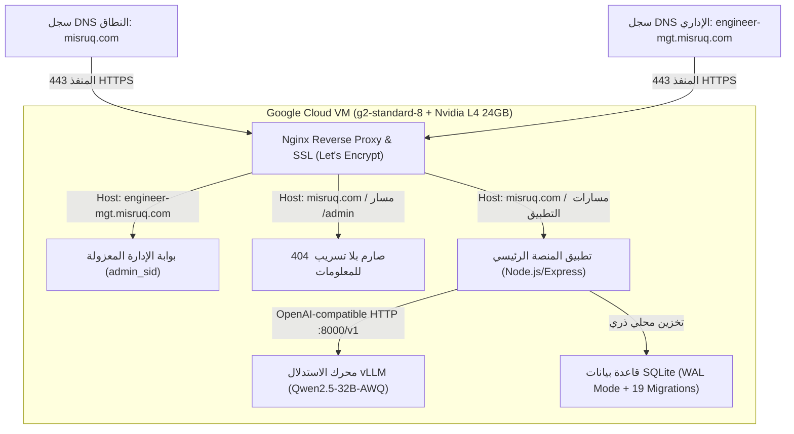

# دليل النشر والتشغيل الإنتاجي على Google Cloud Compute Engine
## المنصة المعرفية والوكيل البرمجي المستقل — بيئة الإنتاج السحابية (Nvidia L4 GPU)

---

### 1. نظرة عامة على المعمارية السحابية (Architecture Overview)

تعتمد المعمارية الإنتاجية على خوادم **Google Cloud Compute Engine (GCE)** فئة `g2-standard-8` المزودة بوحدة تسريع رسومي متطورة **Nvidia L4 (24GB GDDR6 VRAM)** بتسريع أنوية Tensor لمعمارية Ada Lovelace (دعم مدمج لدقة INT4/AWQ و FP8).



---

### 2. معمارية الإنتاج الحالية وخارطة ترقية النموذج (Production Baseline & Model Upgrade Roadmap)

#### 2.1 معمارية الإنتاج الحالية (Production Baseline on `e2-medium`)
> [!IMPORTANT]
> **القرار الهندسي المعتمد للإنتاج الأولي**:
> نظراً لأن مواصفات خادم الإنتاج الأساسي هي **`e2-medium` (2 vCPU / 4 GB RAM، معالج CPU فقط)**، فإن تطبيق المنصة الإنتاجي يعمل حصرياً باستخدام **OpenAI API للمهام المعقدة (`LLM_PROVIDER=openai`)**.
> **المبرر الصارم**: تجنب حشر نموذج محلي داخل 4 GB مشتركة مع محرك Node.js وقاعدة بيانات SQLite ومحرك المراقبة والنسخ الاحتياطي، مما يحمي المنظومة 100% من حوادث نفاد الذاكرة (OOM Crashes) ويضمن استجابات فائقة السرعة للمستخدمين.

| المكون | التكوين الإنتاجي الأساسي (e2-medium Baseline) | التكوين المحلي للتطوير (Local Dev) |
| :--- | :--- | :--- |
| **المثيل (Machine)** | `e2-medium` (2 vCPU / 4 GB RAM) | جهاز التطوير المكتبي (Mac / PC) |
| **مزود النموذج (Provider)** | `LLM_PROVIDER=openai` | `LLM_PROVIDER=ollama` |
| **نقطة النهاية (Base URL)** | `https://api.openai.com/v1` | `http://localhost:11434/v1` |
| **النموذج الافتراضي (Model)** | يُضبط بمتغير بيئة `LLM_MODEL=gpt-4o-mini` | يُضبط بمتغير بيئة `LLM_MODEL=qwen2.5:7b` |
| **التحول السحابي (Cloud Fallback)** | `ALLOW_CLOUD_FALLBACK=false` | `ALLOW_CLOUD_FALLBACK=false` (تعليق معلن) |

---

#### 2.2 جدول المواصفات العتادية الدنيا حسب مقاس النموذج (Model Sizing & Minimum Hardware Matrix)

| مقاس النموذج (Size) | الأمثلة الشائعة | الحد الأدنى للذاكرة (RAM/VRAM) | المعالج الموصى به | زمن الاستجابة (Latency) | التكلفة التقديرية | الملاءمة لـ e2-medium (4GB) |
| :--- | :--- | :--- | :--- | :--- | :--- | :--- |
| **4B** | Qwen2.5-3B / Phi-3 Mini | 4 - 6 GB RAM / 4 GB VRAM | 2-4 vCPUs أو T4 | 2 - 5 ثوانٍ (CPU) | ~$30 - $60 / شهر | ⚠️ خطير: يزاحم ذاكرة التطبيق وSQLite |
| **8B** | Qwen2.5-7B/8B, Llama-3.1-8B | 12 - 16 GB RAM / 8 GB VRAM | 4-8 vCPUs أو T4 (16GB) | 8 - 15 ث (CPU) / 1-2 ث (GPU) | ~$100 - $180 / شهر | ❌ مستحيل عتادياً |
| **14B** | Qwen2.5-14B | 24 - 32 GB RAM / 16 GB VRAM | 8-16 vCPUs أو L4 (24GB) | 18 - 35 ث (CPU) / 1.5-2.5 ث (GPU) | ~$190 - $350 / شهر | ❌ مستحيل عتادياً |
| **27B / 32B** | Qwen2.5-32B AWQ / Qwen3.8-27B | 32 GB+ RAM / 24 GB VRAM | 1x Nvidia L4 24GB (vLLM) | 1.0 - 2.2 ث (GPU) / غير عملي CPU | ~$520 - $620 / شهر | ❌ مستحيل عتادياً |

---

#### 2.3 الخياران الواقعيان للترقية المستقبلية (Two Realistic Upgrade Paths)

1. **الخيار الأول: مسار التكلفة الاقتصادية بدون كرت شاشة (CPU-Only Scale-Up)**
   - **العتاد المستهدف**: ترقية مثيل GCE إلى **`e2-standard-8` (8 vCPU / 32 GB RAM)** بتكلفة تقريبية **~$190 شهرياً**.
   - **النموذج ومحرك التشغيل**: تشغيل **`Qwen2.5-14B-Instruct`** مكمماً بدقة 4-bit (Q4_K_M) محلياً عبر Ollama / llama.cpp على أنوية المعالج.
   - **التقييم الفني**: يضمن سيادة كاملة على البيانات بتكلفة منخفضة، لكن بزمن استجابة أبطأ (18-35 ثانية للاستفسار) وطاقة معالجة متزامنة محدودة.

2. **الخيار الثاني: مسار الأداء العالي والإنتاجية الكثيفة (GPU High-Throughput Scale-Up)**
   - **العتاد المستهدف**: ترقية المثيل إلى **`g2-standard-8` (8 vCPU / 32 GB RAM) مزود بكرت `1x Nvidia L4 (24GB GDDR6 VRAM)`** بتكلفة تقريبية **~$550 - $620 شهرياً**.
   - **النموذج ومحرك التشغيل**: تشغيل **`Qwen/Qwen2.5-32B-Instruct-AWQ` أو `Qwen3.8-27B`** عبر محرك **vLLM** مع تفعيل PagedAttention و Continuous Batching.
   - **التقييم الفني**: سرعة استجابة فائقة (1-2 ثانية)، قدرة هائلة على تخديم عشرات الباحثين المتزامنين، وجودة استدلال تضاهي GPT-4o مع سيادة تامة داخل الشبكة الخاصة.

---

#### 2.4 معايير اتخاذ قرار الترقية (Upgrade Decision Triggers)

| معيار القرار | حد إطلاق الخيار الأول (CPU: e2-standard-8) | حد إطلاق الخيار الثاني (GPU: g2-standard-8 + L4) |
| :--- | :--- | :--- |
| **فاتورة OpenAI API الشهرية** | عند وصول الفاتورة إلى **$150 - $250 / شهر** (نقطة التعادل المالي). | عند تجاوز الفاتورة حاجز **$500 - $600 / شهر**. |
| **حجم الاستفسارات اليومية** | تجاوز **500 - 1,000 استفسار / يومياً**. | تجاوز **2,500 - 5,000 استفسار / يومياً** مع الحاجة للتزامن العالي. |
| **عدد المستخدمين النشطين (DAU)**| **20 - 50 مستخدم نشط يومياً**. | **100+ مستخدم نشط يومياً**. |
| **لوائح خصوصية البيانات والامتثال** | طلب صريح بحظر إرسال أي نص خارج الخادم مع قبول سرعة استجابة هادئة. | اشتراطات سيادية مشددة لحظر الخدمات الخارجية مع اشتراط سرعة إجابة فورية. |

---

### 3. خطوات الإعداد والتنفيذ على Google Cloud CLI (`gcloud`)

#### الخطوة 1: ضبط المشروع والمنطقة الجغرافية
```bash
# تسجيل الدخول وتحديد المشروع
gcloud auth login
gcloud config set project YOUR_GCP_PROJECT_ID
gcloud config set compute/region me-central1
gcloud config set compute/zone me-central1-a
```

#### الخطوة 2: إنشاء مستودع الصور في Google Artifact Registry
```bash
gcloud artifacts repositories create platform-repo \
    --repository-format=docker \
    --location=me-central1 \
    --description="Docker repository for Knowledge Platform production images"

# تسجيل اعتمادية Docker
gcloud auth configure-docker me-central1-docker.pkg.dev
```

#### الخطوة 3: حجز عنوان IP خارجي ثابت (Static External IP)
> [!IMPORTANT]
> حجز العنوان الثابت يضمن عدم تغير IP الخادم عند إعادة التشغيل، ويتيح ربط سجلات DNS بشكل دائم دون انقطاع.

```bash
# حجز العنوان الثابت
gcloud compute addresses create platform-production-ip --region=me-central1

# استخراج القيمة الدقيقة للعنوان
STATIC_IP=$(gcloud compute addresses describe platform-production-ip --region=me-central1 --format="value(address)")
echo "Reserved Static IP: ${STATIC_IP}"
```

#### الخطوة 4: إنشاء مثيل Compute Engine مع كرت الشاشة Nvidia L4
```bash
gcloud compute instances create platform-production-vm \
    --zone=me-central1-a \
    --machine-type=g2-standard-8 \
    --accelerator=type=nvidia-l4,count=1 \
    --maintenance-policy=TERMINATE \
    --address=${STATIC_IP} \
    --image-family=common-cu121-debian-11-py310 \
    --image-project=deeplearning-platform-release \
    --boot-disk-size=200GB \
    --boot-disk-type=pd-ssd \
    --tags=http-server,https-server
```

#### الخطوة 5: فتح المنافذ الشبكية (Firewall Rules)
```bash
gcloud compute firewall-rules create allow-http-https \
    --direction=INGRESS \
    --priority=1000 \
    --network=default \
    --action=ALLOW \
    --rules=tcp:80,tcp:443 \
    --source-ranges=0.0.0.0/0 \
    --target-tags=http-server,https-server
```

---

### 4. إعداد سجلات DNS (DNS Records Configuration)

قم بإنشاء السجلات التالية لدى مزود النطاق (Cloudflare / Namecheap / Google Domains):

| النوع (Type) | اسم المضيف (Host) | القيمة (Value / Target) | الشرح |
| :--- | :--- | :--- | :--- |
| **A** | `@` (أو `misruq.com`) | `${STATIC_IP}` | النطاق الرئيسي لتطبيق المستخدمين العاديين. |
| **A** | `engineer-mgt` | `${STATIC_IP}` | **النطاق الإداري الحصري المنفصل** (`ADMIN_HOST=engineer-mgt.misruq.com`). |

---

### 5. ملفات تشغيل الحاويات في الإنتاج (`docker-compose.prod.yml`)

أنشئ ملف `docker-compose.prod.yml` داخل الخادم:

```yaml
version: '3.8'

services:
  # 1. محرك الاستدلال عالي الأداء vLLM مع تسريع Nvidia L4
  vllm-engine:
    image: vllm/vllm-openai:latest
    container_name: vllm-inference
    restart: always
    environment:
      - HUGGING_FACE_HUB_TOKEN=${HF_TOKEN:-}
    ports:
      - "127.0.0.1:8000:8000"
    volumes:
      - /root/.cache/huggingface:/root/.cache/huggingface
    ipc: host
    deploy:
      resources:
        reservations:
          devices:
            - driver: nvidia
              count: 1
              capabilities: [gpu]
    command: >
      --model Qwen/Qwen2.5-32B-Instruct-AWQ
      --quantization awq
      --dtype auto
      --max-model-len 16384
      --gpu-memory-utilization 0.90
      --enforce-eager
      --port 8000

  # 2. تطبيق المنصة المعرفية الرئيسي
  knowledge-app:
    image: me-central1-docker.pkg.dev/${GCP_PROJECT_ID}/platform-repo/knowledge-platform:latest
    container_name: knowledge-platform-app
    restart: always
    depends_on:
      - vllm-engine
    ports:
      - "127.0.0.1:3000:3000"
    environment:
      - NODE_ENV=production
      - PORT=3000
      - ADMIN_HOST=engineer-mgt.misruq.com
      - LLM_PROVIDER=vllm
      - LLM_BASE_URL=http://vllm-engine:8000/v1
      - LLM_MODEL=Qwen/Qwen2.5-32B-Instruct-AWQ
      - ALLOW_CLOUD_FALLBACK=false
      - DATA_DIR=/app/data
      - SESSION_SECRET=${PROD_SESSION_SECRET}
      - ADMIN_EMAIL=admin@misruq.com
      - ADMIN_INITIAL_PASSWORD=${ADMIN_BOOTSTRAP_PASSWORD}
      - ADMIN_TOTP_SECRET=${ADMIN_TOTP_SECRET}
    volumes:
      - platform-sqlite-data:/app/data
      - platform-vault:/app/vault

volumes:
  platform-sqlite-data:
  platform-vault:
```

---

### 6. إعداد خادم Nginx العازل وشهادة SSL (Let's Encrypt)

أنشئ ملف التكوين في الخادم `/etc/nginx/sites-available/misruq.conf`:

```nginx
# 1. النطاق الإداري المنفصل (engineer-mgt.misruq.com)
server {
    server_name engineer-mgt.misruq.com;

    location / {
        proxy_pass http://127.0.0.1:3000;
        proxy_set_header Host $host;
        proxy_set_header X-Forwarded-Host $host;
        proxy_set_header X-Real-IP $remote_addr;
        proxy_set_header X-Forwarded-For $proxy_add_x_forwarded_for;
        proxy_set_header X-Forwarded-Proto $scheme;
        proxy_read_timeout 300s;
    }

    # حماية إضافية لهيدرز الأمان
    add_header X-Frame-Options "DENY" always;
    add_header X-Content-Type-Options "nosniff" always;
    add_header Referrer-Policy "strict-origin-when-cross-origin" always;
}

# 2. النطاق العام للمستخدمين (misruq.com)
server {
    server_name misruq.com;

    # حظر حاسم وصامت لمسار لوحة الإدارة على النطاق العام
    location ~* ^/(admin|portal/admin) {
        return 404;
    }

    location / {
        proxy_pass http://127.0.0.1:3000;
        proxy_set_header Host $host;
        proxy_set_header X-Forwarded-Host $host;
        proxy_set_header X-Real-IP $remote_addr;
        proxy_set_header X-Forwarded-For $proxy_add_x_forwarded_for;
        proxy_set_header X-Forwarded-Proto $scheme;
        proxy_read_timeout 300s;
    }
}
```

تفعيل التكوين واستخراج شهادات SSL تلقائياً:
```bash
sudo ln -s /etc/nginx/sites-available/misruq.conf /etc/nginx/sites-enabled/
sudo nginx -t && sudo systemctl reload nginx
sudo certbot --nginx -d misruq.com -d engineer-mgt.misruq.com --non-interactive --agree-tos -m admin@misruq.com
```

---

### 7. خطة الفحص والتحقق بعد النشر (Post-Deployment Verification)

```bash
# 1. التحقق من سلامة استجابة خادم vLLM
curl http://127.0.0.1:8000/v1/models

# 2. التحقق من الحظر الصارم (404) على النطاق الرئيسي لمسارات الإدارة
curl -I -H "Host: misruq.com" https://${STATIC_IP}/admin
# النتيجة المتوقعة: HTTP/1.1 404 Not Found

# 3. التحقق من عمل لوحة الإدارة الحصرية على النطاق المخصص
curl -I -H "Host: engineer-mgt.misruq.com" https://${STATIC_IP}/
# النتيجة المتوقعة: HTTP/1.1 200 OK (لوحة الإدارة مع 2FA)
```
