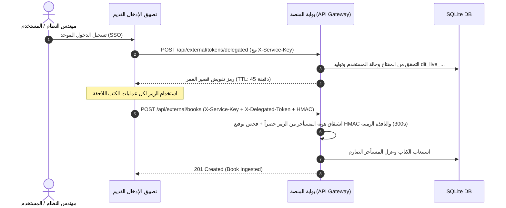

# دليل الربط والتكامل: واجهة برمجة تطبيقات الإدخال الخارجي والتوثيق المفوض
## Legacy Ingestion Service API Specification & Hardened Integration Guide

هذا الدليل مخصص لمطوري تطبيق الإدخال القديم (React / Node.js / Python) لشرح كيفية ربط واستيعاب الكتب وإدارتها في منصة **المهندس (Engineer)** عبر **مفاتيح الخدمات الآمنة (Service API Keys)** والرموز المفوضة قصيرة العمر (**Delegated Tokens**) مع التوقيع الرقمي **HMAC-SHA256**.

---

## 1. نموذج الأمان الثلاثي الصارم (Three-Tier Security Model)

لحماية بيانات المستأجرين وسد أي ثغرة ادعاء هوية غير مؤكدة (`X-User-Id` spoofing)، تعتمد المنظومة نموذج أمان ثلاثي:



### القواعد الأمنية الثلاث الأساسية:
1. **رمز تفويض لكل مستخدم (Per-User Delegated Token)**:
   - بعد الدخول الموحد، يُصدر للمستخدم رمز تفويض قصير العمر (**30 إلى 60 دقيقة**، افتراضياً 45 دقيقة).
   - يُرسل في ترويسة `X-Delegated-Token`.
   - **تُشتق هوية المستخدم وصلاحياته حصراً من الرمز المخزن بالخادم**، ولا يُقبل ادعاء `X-User-Id` مجرداً. إذا أُرسلت ترويسة `X-User-Id` فإنها تُطابق إجبارياً مع مالك الرمز؛ وأي اختلاف يُرفض بـ `403 IDENTITY_MISMATCH` مع بلاغ أمني فوري.
2. **تقييد المنشأ الشبكي (Network Origin Restriction)**:
   - يُقبل الاتصال فقط من الشبكة المحلية (`127.0.0.1` أو `::1`) أو النطاقات الفرعية الخاصة بـ RFC 1918 (`10.0.0.0/8`, `172.16.0.0/12`, `192.168.0.0/16`).
   - يُرفض أي اتصال مباشر من الإنترنت العام برمز **`HTTP 403 NETWORK_RESTRICTED`**.
3. **التوقيع الرقمي ونافذة منع إعادة الإرسال (HMAC-SHA256 & Anti-Replay)**:
   - في بيئة الإنتاج (`production`)، يُلزم كل طلب بترويستي `X-Timestamp` و`X-Signature`.
   - نافذة الانحراف الزمني المسموح بها هي **300 ثانية** (5 دقائق). أي طلب يتجاوزها يُرفض بـ `403 REQUEST_EXPIRED`.
   - التوقيع يُحسب بالمعادلة الكنسية:
     $$\text{HMAC-SHA256}(\text{KeyHash}, \text{Method} + "\backslash\text{n}" + \text{Path} + "\backslash\text{n}" + \text{Timestamp} + "\backslash\text{n}" + \text{DelegatedToken} + "\backslash\text{n}" + \text{SHA256}(\text{Body}))$$

---

## 2. الترويسات الإلزامية للطلبات (Headers Reference)

| الترويسة (Header) | الإلزامية | الوصف | مثال |
| :--- | :--- | :--- | :--- |
| `X-Service-Key` | **إلزامي** | مفتاح الخدمة المشتق من لوحة الإدارة (`sk_live_...`). | `sk_live_a1b2c3d4...` |
| `X-Delegated-Token` | **إلزامي لعمليات الكتب** | رمز التفويض قصير العمر للمستخدم (`dit_live_...`). | `dit_live_9f82c7a...` |
| `X-Timestamp` | **إلزامي في الإنتاج** | الطابع الزمني للطلب بتنسيق ISO-8601 لمنع إعادة الإرسال. | `2026-11-09T08:00:00.000Z` |
| `X-Signature` | **إلزامي في الإنتاج** | توقيع HMAC بصيغة `sha256=<hex_digest>`. | `sha256=e3b0c44298fc...` |
| `Idempotency-Key` | موصى به للإنشاء | مفتاح منع التكرار لضمان أن 3 استدعاءات متطابقة تُنتج كتاباً واحداً فقط. | `idem_req_99812` |
| `Content-Type` | حسب نوع الطلب | `multipart/form-data` للكتب أو `application/json` للبيانات. | `application/json` |

---

## 3. محدد المعدل (Rate Limiting)

- **الحد الأقصى**: **60 طلباً في الدقيقة** لكل مفتاح خدمة (نافذة منزلقة 60 ثانية).
- **عند التجاوز**: يعود الخادم فوراً برمز **`HTTP 429 Too Many Requests`** مع ترويسة `Retry-After: 60`.

---

## 4. نقاط النهاية المتاحة (API Endpoints Reference)

### 0) إصدار رمز تفويض لمستخدم (Issue Delegated Token)
- **المسار**: `POST /api/external/tokens/delegated`
- **نوع المحتوى**: `application/json`
- **الترويسات**: `X-Service-Key`
- **الجسم (Payload)**:
  - `userId` (إلزامي): معرف المستخدم في المنظومة.
  - `ttlMinutes` (اختياري، 30-60 دقيقة، الافتراضي 45 دقيقة).

```bash
curl -X POST https://api.cloudstudio.dev/api/external/tokens/delegated \
  -H "X-Service-Key: sk_live_your_secret_key" \
  -H "Content-Type: application/json" \
  -d '{
    "userId": "usr_engineer_salem",
    "ttlMinutes": 45
  }'
```

#### الاستجابة (`201 Created`):
```json
{
  "success": true,
  "delegatedToken": "dit_live_8e3f4b119a02bc7...",
  "id": "dit_01h8abc999",
  "userId": "usr_engineer_salem",
  "expiresAt": "2026-11-09T08:45:00.000Z",
  "ttlSeconds": 2700,
  "ttlMinutes": 45
}
```

---

### 1) استيعاب كتاب جديد (Ingest New Book)
- **المسار**: `POST /api/external/books`
- **نوع المحتوى**: `multipart/form-data`
- **الترويسات**: `X-Service-Key`, `X-Delegated-Token`, `Idempotency-Key`
- **الحقول**:
  - `file`: ملف PDF أو النص.
  - `title`: عنوان الكتاب.
  - `author`: اسم المؤلف.
  - `language`: لغة المحتوى (الافتراضي: Arabic).

```bash
curl -X POST https://api.cloudstudio.dev/api/external/books \
  -H "X-Service-Key: sk_live_your_service_key" \
  -H "X-Delegated-Token: dit_live_your_delegated_token" \
  -H "Idempotency-Key: idem_unique_upload_001" \
  -F "file=@/path/to/my_book.pdf" \
  -F "title=كتاب الهندسة المعمارية المتقدمة" \
  -F "author=د. سالم القحطاني"
```

---

### 2) تعديل البيانات الوصفية (Metadata Update)
- **المسار**: `PATCH /api/external/books/:id`
- **نوع المحتوى**: `application/json`
- **الوظيفة**: تعديل بيانات الكتاب الوصفية مع الحفاظ الصارم على الفهارس والمقاطع دون حاجة لإعادة المعالجة.

```bash
curl -X PATCH https://api.cloudstudio.dev/api/external/books/doc_01h8xyz999 \
  -H "X-Service-Key: sk_live_your_service_key" \
  -H "X-Delegated-Token: dit_live_your_delegated_token" \
  -H "Content-Type: application/json" \
  -d '{
    "title": "كتاب الهندسة المعمارية - الطبعة المعتمدة 2026",
    "edition": "الطبعة الثانية"
  }'
```

---

### 3) الاستبدال الذري للمحتوى (Atomic Replace)
- **المسار**: `POST /api/external/books/:id/replace`
- **نوع المحتوى**: `multipart/form-data`
- **الوظيفة**: استبدال محتوى الكتاب القديم بملف جديد ذرياً. يضمن النظام تطهير الفهرس القديم وبناء الفهرس الجديد دون أي فترة زمنية يتعايش فيها المحتويان في نتائج البحث.

---

### 4) الحذف الشامل والفوري (Purge Cascade Delete)
- **المسار**: `DELETE /api/external/books/:id`
- **الضمانات**:
  - تصفير فوري لـ 9 جداول بقاعدة البيانات (`documents`, `chunks`, `book_structures`, `book_pages`, `document_tables`, `document_figures`, `research_evidence`, `research_citations`, `processing_jobs`).
  - **صفر نتائج بحث خلال أقل من ثانية واحدة**.
  - **صفر صفوف يتيمة**.

```bash
curl -X DELETE https://api.cloudstudio.dev/api/external/books/doc_01h8xyz999 \
  -H "X-Service-Key: sk_live_your_service_key" \
  -H "X-Delegated-Token: dit_live_your_delegated_token"
```

---

### 5) الاستعلام عن حالة استيعاب الكتاب (Status Query)
- **المسار**: `GET /api/external/books/:id/status`

---

## 5. نموذج كود Node.js / TypeScript متكامل مع HMAC والرمز المفوض

```typescript
import crypto from 'crypto';
import axios from 'axios';

interface RequestSignerOptions {
  method: string;
  path: string;
  serviceKeyHash: string;
  delegatedToken: string;
  body?: any;
}

export function generateHmacHeaders({ method, path, serviceKeyHash, delegatedToken, body }: RequestSignerOptions) {
  const timestamp = new Date().toISOString();
  let bodyText = '';
  if (body && typeof body === 'object' && Object.keys(body).length > 0) {
    bodyText = JSON.stringify(body);
  } else if (typeof body === 'string') {
    bodyText = body;
  }
  const bodyHash = crypto.createHash('sha256').update(bodyText).digest('hex');
  const canonicalString = `${method.toUpperCase()}\n${path}\n${timestamp}\n${delegatedToken}\n${bodyHash}`;
  const hmac = crypto.createHmac('sha256', serviceKeyHash).update(canonicalString).digest('hex');

  return {
    'X-Timestamp': timestamp,
    'X-Signature': `sha256=${hmac}`,
  };
}

export async function ingestBookSecurely(serviceKey: string, serviceKeyHash: string, delegatedToken: string, payload: any) {
  const path = '/api/external/books';
  const url = `https://127.0.0.1:4000${path}`;
  const hmacHeaders = generateHmacHeaders({
    method: 'POST',
    path,
    serviceKeyHash,
    delegatedToken,
    body: payload,
  });

  const response = await axios.post(url, payload, {
    headers: {
      'X-Service-Key': serviceKey,
      'X-Delegated-Token': delegatedToken,
      'Idempotency-Key': `idem_${Date.now()}_${Math.random().toString(36).slice(2, 8)}`,
      ...hmacHeaders,
    },
  });

  return response.data;
}
```

---

## 6. جدول رموز وأسباب الأخطاء الأمنية (Error Reference)

| رمز الحالة | كود الخطأ (`code`) | السبب والإجراء المطلوب |
| :--- | :--- | :--- |
| `401` | `MISSING_SERVICE_KEY` | ترويسة `X-Service-Key` مفقودة. |
| `401` | `INVALID_SERVICE_KEY` | مفتاح الخدمة غير صحيح. |
| `401` | `DELEGATED_TOKEN_REQUIRED` | مطلوب ترويسة `X-Delegated-Token` صالحة. |
| `401` | `DELEGATED_TOKEN_EXPIRED` | انتهت صلاحية رمز التفويض (تجاوز 30-60 دقيقة)، يلزم التجديد. |
| `403` | `DELEGATED_TOKEN_REVOKED` | تم إبطال رمز التفويض فورياً من الإدارة. |
| `403` | `IDENTITY_MISMATCH` | ترويسة `X-User-Id` لا تطابق مالك الرمز المفوض (محاولة انتحال هوية). |
| `403` | `NETWORK_RESTRICTED` | تم حظر الطلب لوروده من خارج الشبكة المصرح بها (Loopback / RFC 1918). |
| `403` | `SIGNATURE_REQUIRED` | ترويسة التوقيع `X-Signature` مطلوبة في بيئة الإنتاج. |
| `403` | `INVALID_SIGNATURE` | توقيع HMAC غير صحيح أو تم التلاعب بجسم الطلب. |
| `403` | `REQUEST_EXPIRED` | انحراف الطابع الزمني `X-Timestamp` تجاوز 300 ثانية (حماية ضد Replay). |
| `403` | `SERVICE_KEY_REVOKED` | تم إبطال مفتاح الخدمة فورياً (< 60 ثانية). |
| `403` | `FORBIDDEN_CROSS_TENANT` | محاولة وصول لكتاب مملوك لمستأجر آخر. |
| `429` | `RATE_LIMIT_EXCEEDED` | تم تجاوز حد 60 طلباً / دقيقة. |
