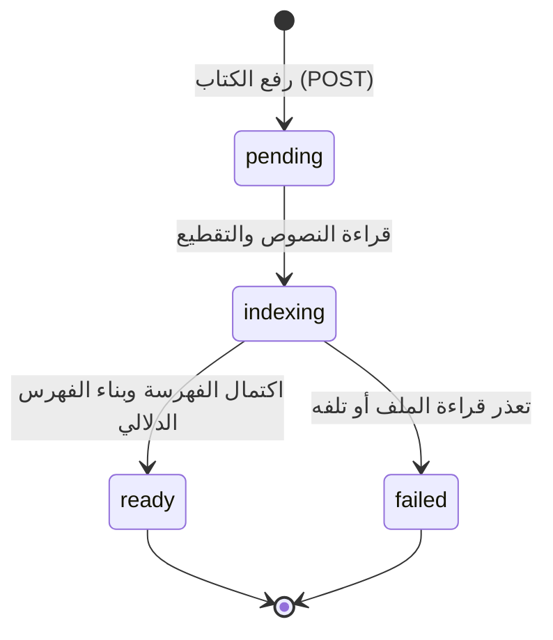

# دليل الربط والتكامل: واجهة برمجة تطبيقات الإدخال الخارجي
## Legacy Ingestion Service API Specification & Integration Guide

هذا الدليل مخصص لمطوري تطبيق الإدخال القديم (React / Node.js) لشرح كيفية ربط واستيعاب الكتب وإدارتها في منصة **المهندس (Engineer)** عبر **مفاتيح الخدمات الآمنة (Service API Keys)**.

---

## 1. مبادئ الأمان والترويسات الإلزامية (Security & Mandatory Headers)

يتم التواصل مع المنصة حصراً عبر بروتوكول **HTTPS**، ويتطلب كل استدعاء الترويسات التالية:

| الترويسة (Header) | الإلزامية | الوصف | مثال |
| :--- | :--- | :--- | :--- |
| `X-Service-Key` | **إلزامي** | مفتاح الخدمة المولد من لوحة الإدارة (يبدأ بـ `sk_live_`). | `sk_live_9f82c7a...` |
| `X-User-Id` | **إلزامي** | معرف المستخدم المالك للكتاب في منصة المهندس (يحقق العزل الصارم للمستأجرين). | `usr_01h8abc123` |
| `Idempotency-Key` | **موصى به / إلزامي للإنشاء** | معرف فريد للطلب لمنع تكرار إدخال الكتاب عند انقطاع الشبكة. | `idem_upload_99812` |
| `Content-Type` | حسب نوع الطلب | `multipart/form-data` للملفات، أو `application/json` للبيانات الوصفية. | `multipart/form-data` |

> [!CAUTION]
> **عزل المستأجرين (Tenant Isolation)**:
> منصة المهندس تطبق سياسة عزل صارمة غير قابلة للاختراق. لا يمكن لأي طلب تعديل أو حذف أو قراءة كتاب مملوك لمستخدم آخر غير المحدد في `X-User-Id`. أي محاولة غير مصرح بها ستُرفض برمز **`HTTP 403 Forbidden`** مع تسجيل بلاغ أمني عالي الخطورة.

---

## 2. محدد المعدل (Rate Limiting)

- **الحد الأقصى**: **60 طلباً في الدقيقة** لكل مفتاح خدمة (نافذة منزلقة 60 ثانية).
- **عند التجاوز**: يعود الخادم فوراً برمز **`HTTP 429 Too Many Requests`** مع ترويسة `Retry-After: <ثواني>`.

---

## 3. دورة حياة حالة الاستيعاب (Book Ingestion Lifecycle)



- `pending`: تم استلام الملف وحفظه بنجاح وفي انتظار بدء الاستخراج.
- `indexing`: جارٍ استخراج النصوص وفهرسة المقاطع والجداول.
- `ready`: الكتاب مفهرس بالكامل وجاهز لاسترجاع المعرفة والإجابات الفورية.
- `failed`: حدث خطأ في المعالجة (يمكن فحص `failure_reason`).

---

## 4. نقاط النهاية المتاحة (API Endpoints Reference)

### 1) رفع واستيعاب كتاب جديد
- **المسار**: `POST /api/external/books`
- **نوع المحتوى**: `multipart/form-data`
- **الحقول المدعومة**:
  - `file`: ملف الكتاب (`application/pdf`, `text/plain`, إلخ).
  - `title`: عنوان الكتاب (اختياري، الافتراضي هو اسم الملف).
  - `author`: اسم المؤلف (اختياري).
  - `edition`: الطبعة (اختياري).
  - `publication_year`: سنة النشر (اختياري، رقم).
  - `language`: لغة الكتاب (الافتراضي `Arabic`).
  - `category_id`: معرف التصنيف (اختياري).
  - `content_type`: نوع المحتوى (افتراضياً `application/pdf`).
  - `chapters`: هيكل الفصول بتنسيق JSON (اختياري).

#### مثال استدعاء باستخدام cURL:
```bash
curl -X POST https://api.cloudstudio.dev/api/external/books \
  -H "X-Service-Key: sk_live_your_secret_key_here" \
  -H "X-User-Id: usr_salem_123" \
  -H "Idempotency-Key: req_upload_book_001" \
  -F "file=@/path/to/my_book.pdf" \
  -F "title=كتاب الهندسة المعمارية المتقدمة" \
  -F "author=د. سالم القحطاني" \
  -F "language=Arabic"
```

#### نموذج الاستجابة الناجحة (`201 Created`):
```json
{
  "success": true,
  "book_id": "doc_01h8xyz999",
  "title": "كتاب الهندسة المعمارية المتقدمة",
  "status": "ready",
  "chunks_count": 48,
  "pages_count": 12,
  "created_at": "2026-11-09T07:22:00.000Z"
}
```

---

### 2) تعديل البيانات الوصفية (Metadata Update)
- **المسار**: `PATCH /api/external/books/:id`
- **نوع المحتوى**: `application/json`
- **الوظيفة**: تعديل الحقول الوصفية (العنوان، المؤلف، الطبعة، سنة النشر، الفصول) **دون إعادة استيعاب أو تغيير المقاطع المفهرسة**.

#### مثال استدعاء باستخدام cURL:
```bash
curl -X PATCH https://api.cloudstudio.dev/api/external/books/doc_01h8xyz999 \
  -H "X-Service-Key: sk_live_your_secret_key_here" \
  -H "X-User-Id: usr_salem_123" \
  -H "Content-Type: application/json" \
  -d '{
    "title": "كتاب الهندسة المعمارية المتقدمة - الطبعة الثانية المعتمدة",
    "edition": "الطبعة الثانية",
    "publication_year": 2026
  }'
```

#### نموذج الاستجابة الناجحة (`200 OK`):
```json
{
  "success": true,
  "book_id": "doc_01h8xyz999",
  "title": "كتاب الهندسة المعمارية المتقدمة - الطبعة الثانية المعتمدة",
  "author": "د. سالم القحطاني",
  "edition": "الطبعة الثانية",
  "publication_year": 2026,
  "language": "Arabic",
  "category_id": "cat_default",
  "chapters": [],
  "updated_at": "2026-11-09T07:22:30.000Z"
}
```

---

### 3) الاستبدال الذري لمحتوى الكتاب (Atomic Replace)
- **المسار**: `POST /api/external/books/:id/replace`
- **نوع المحتوى**: `multipart/form-data`
- **الوظيفة**: رفع ملف جديد يحل محل المحتوى القديم. يتم استيعاب الملف الجديد وتطهير فهرس النسخة القديمة ذرياً (Atomic)؛ بحيث يضمن النظام **عدم وجود النسختين قابلتين للاسترجاع في أي لحظة زمنية معاً**.

#### مثال استدعاء cURL:
```bash
curl -X POST https://api.cloudstudio.dev/api/external/books/doc_01h8xyz999/replace \
  -H "X-Service-Key: sk_live_your_secret_key_here" \
  -H "X-User-Id: usr_salem_123" \
  -F "file=@/path/to/updated_book_v2.pdf" \
  -F "title=كتاب الهندسة المعمارية (نسخة منقحة)"
```

#### نموذج الاستجابة الناجحة (`200 OK`):
```json
{
  "success": true,
  "book_id": "doc_01h8xyz999",
  "replaced": true,
  "title": "كتاب الهندسة المعمارية (نسخة منقحة)",
  "status": "ready",
  "chunks_count": 54,
  "pages_count": 14,
  "updated_at": "2026-11-09T07:23:00.000Z"
}
```

---

### 4) الحذف الشامل والفوري (Purge Delete)
- **المسار**: `DELETE /api/external/books/:id`
- **الوظيفة**: حذف كامل وفوري يشمل: سجل المستند (`documents`)، جميع المقاطع (`chunks`)، الجداول، الأشكال، الفصول، الأدلة، والملف الفيزيائي.
- **الضمان**: بعد تنفيذ هذا الأمر، يعيد أي بحث دلالي أو نصي **صفر نتائج خلال أقل من ثانية واحدة**، ولا يبقى صف يتيم واحد في قاعدة البيانات.

#### مثال استدعاء cURL:
```bash
curl -X DELETE https://api.cloudstudio.dev/api/external/books/doc_01h8xyz999 \
  -H "X-Service-Key: sk_live_your_secret_key_here" \
  -H "X-User-Id: usr_salem_123"
```

#### نموذج الاستجابة الناجحة (`200 OK`):
```json
{
  "success": true,
  "book_id": "doc_01h8xyz999",
  "deleted": true,
  "purged_tables": [
    "documents",
    "chunks",
    "book_structures",
    "book_pages",
    "document_tables",
    "document_figures",
    "research_evidence",
    "research_citations",
    "processing_jobs"
  ],
  "timestamp": "2026-11-09T07:23:30.000Z"
}
```

---

### 5) الاستعلام عن حالة استيعاب كتاب (Ingestion Status)
- **المسار**: `GET /api/external/books/:id/status`
- **الوظيفة**: متابعة حالة معالجة الكتاب وسجل الأخطاء إن وجدت.

#### مثال استدعاء cURL:
```bash
curl -X GET https://api.cloudstudio.dev/api/external/books/doc_01h8xyz999/status \
  -H "X-Service-Key: sk_live_your_secret_key_here" \
  -H "X-User-Id: usr_salem_123"
```

#### نموذج الاستجابة الناجحة (`200 OK`):
```json
{
  "book_id": "doc_01h8xyz999",
  "title": "كتاب الهندسة المعمارية المتقدمة",
  "status": "ready",
  "failure_reason": null,
  "pages_total": 12,
  "chunks_count": 48,
  "created_at": "2026-11-09T07:22:00.000Z",
  "updated_at": "2026-11-09T07:22:00.000Z"
}
```

---

## 5. نموذج كود React / Node.js متكامل

```typescript
import axios from 'axios';
import FormData from 'form-data';
import fs from 'fs';

const SERVICE_KEY = process.env.ENGINEER_SERVICE_KEY;
const API_BASE = 'https://api.cloudstudio.dev/api/external/books';

export async function uploadBookFromLegacySystem(userId: string, filePath: string, title: string) {
  const form = new FormData();
  form.append('file', fs.createReadStream(filePath));
  form.append('title', title);
  form.append('author', 'إدارة المحتوى');
  form.append('language', 'Arabic');

  const idempotencyKey = `ingest_${Date.now()}_${Math.random().toString(36).slice(2, 7)}`;

  try {
    const response = await axios.post(API_BASE, form, {
      headers: {
        ...form.getHeaders(),
        'X-Service-Key': SERVICE_KEY,
        'X-User-Id': userId,
        'Idempotency-Key': idempotencyKey,
      },
    });

    console.log('Book ingested successfully:', response.data.book_id);
    return response.data;
  } catch (error: any) {
    if (error.response?.status === 429) {
      const retryAfter = error.response.headers['retry-after'] || 60;
      console.warn(`Rate limit reached. Retrying after ${retryAfter} seconds...`);
    } else if (error.response?.status === 403) {
      console.error('Security or Tenant violation:', error.response.data);
    } else {
      console.error('Ingestion failed:', error.message);
    }
    throw error;
  }
}
```

---

## 6. جدول رموز وأسباب الأخطاء (Error Responses)

| رمز الحالة | كود الخطأ (`code`) | الرسالة الدلالية |
| :--- | :--- | :--- |
| `400` | `MISSING_USER_IDENTITY` | ترويسة هوية المستخدم `X-User-Id` مفقودة. |
| `400` | `EMPTY_BOOK_CONTENT` | محتوى الملف المرفوع فارغ أو تعذرت قراءته. |
| `401` | `MISSING_SERVICE_KEY` | ترويسة `X-Service-Key` مفقودة في الطلب. |
| `401` | `INVALID_SERVICE_KEY` | مفتاح الخدمة غير صحيح أو غير مسجل بالمنظومة. |
| `403` | `SERVICE_KEY_REVOKED` | تم إبطال مفتاح الخدمة من لوحة الإدارة. |
| `403` | `INSUFFICIENT_SCOPE` | المفتاح لا يملك صلاحية `books:crud`. |
| `403` | `FORBIDDEN_CROSS_TENANT` | محاولة الوصول لكتاب مملوك لمستخدم آخر. |
| `404` | `BOOK_NOT_FOUND` | الكتاب المطلوب غير موجود. |
| `429` | `RATE_LIMIT_EXCEEDED` | تم تجاوز حد 60 طلباً / دقيقة. |
| `500` | `INTERNAL_SERVER_ERROR` | خطأ داخلي في الخادم أو محرك الفهرسة. |
